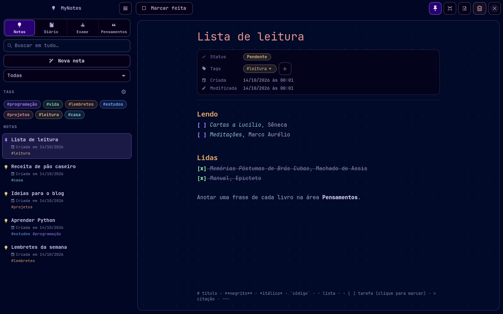
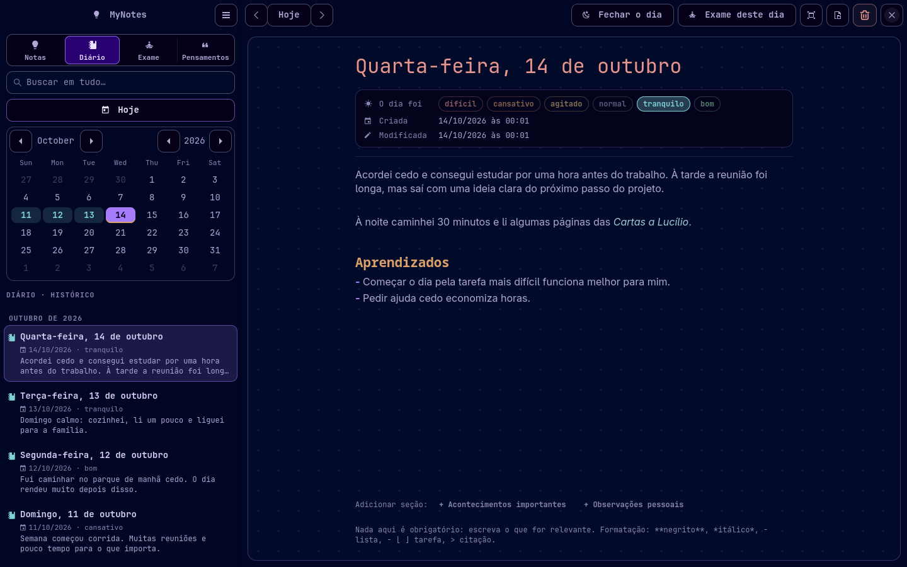
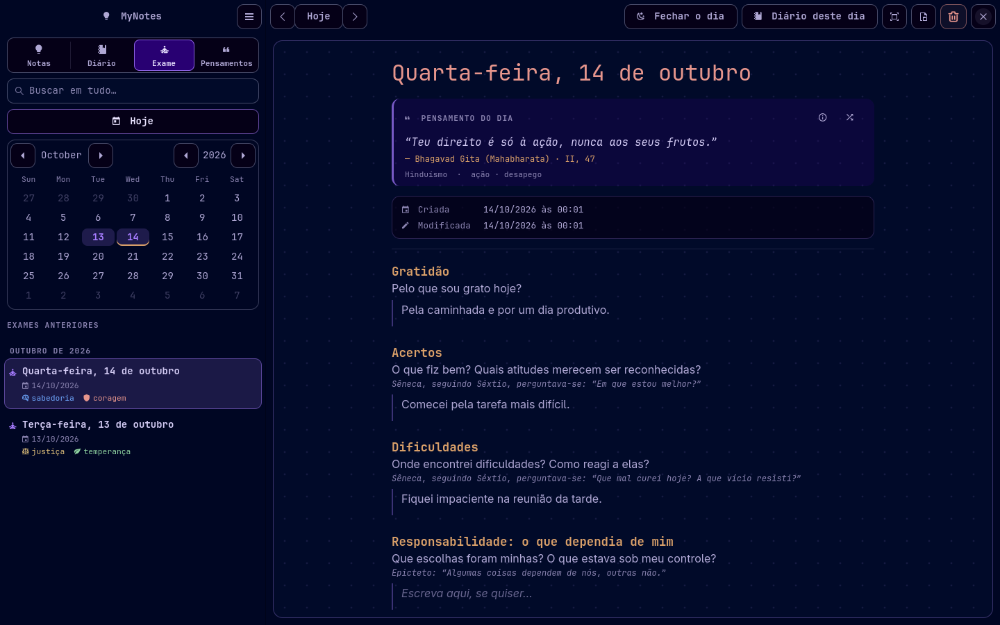
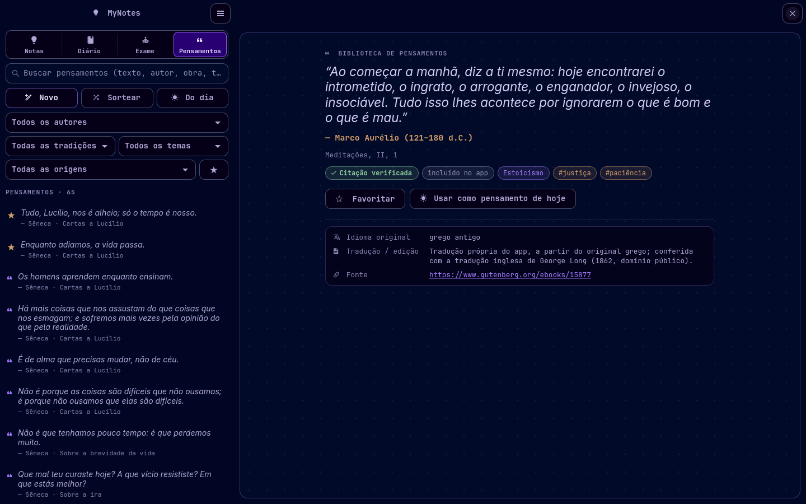
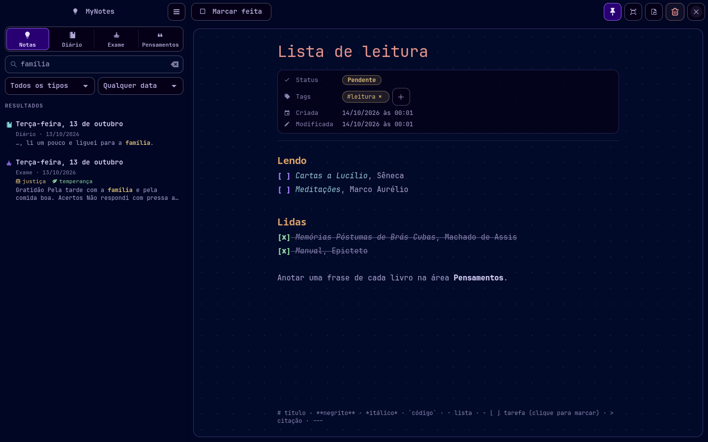
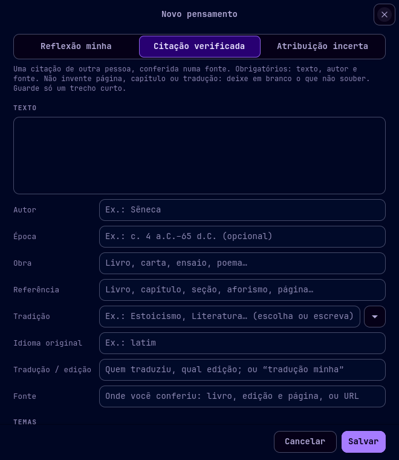
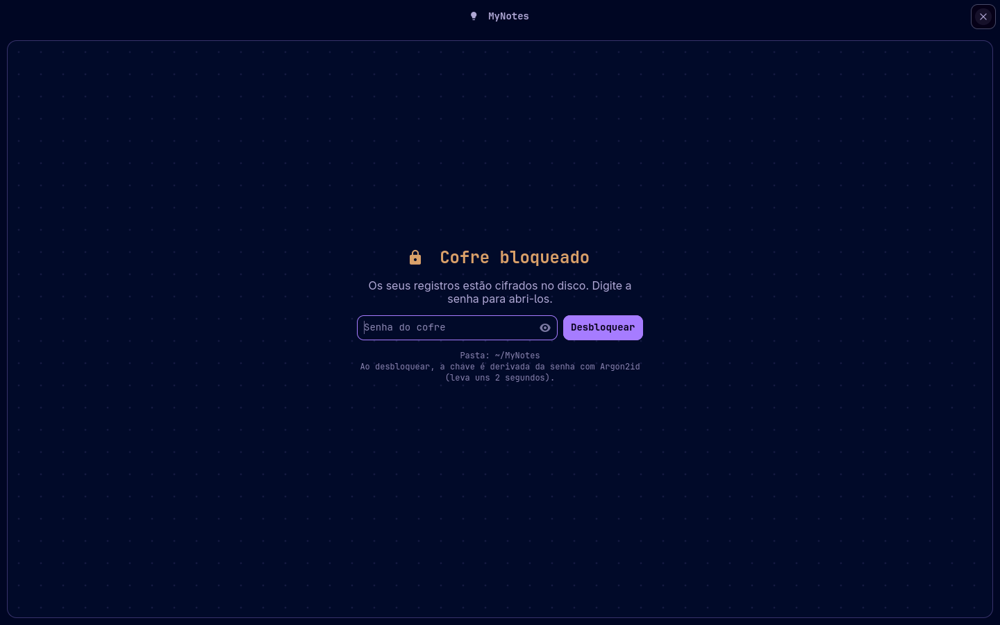
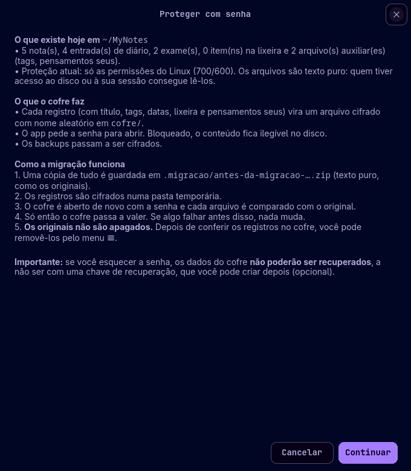
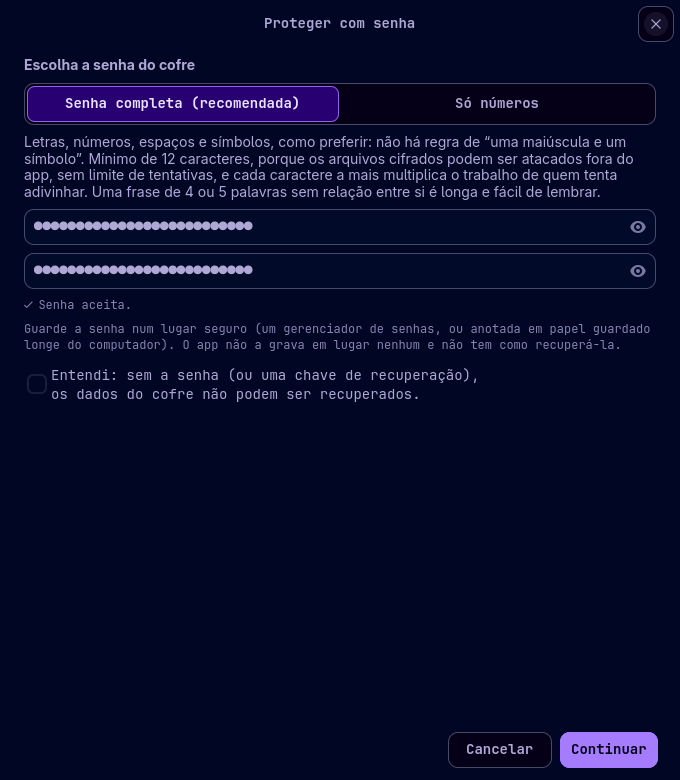

# MyNotes

**Notas, diário, exame de consciência e uma biblioteca de pensamentos, num app de desktop para Linux.**
Tudo fica no seu computador, em arquivos Markdown comuns, com um **cofre criptografado com senha**
opcional. Não há nuvem, conta, anúncios nem rastreamento: o app não usa a internet.

> *English summary:* MyNotes is a GTK4/libadwaita desktop app for Linux (Python, single file) with
> notes, a daily journal, a guided evening review inspired by Stoic practice, and a library of
> verified quotes from philosophers and writers. Data is stored locally as plain Markdown, with an
> optional password-protected encrypted vault (libsodium: Argon2id + XChaCha20-Poly1305).
> The interface is in Brazilian Portuguese.



## Sumário

- [O que o app faz](#o-que-o-app-faz)
- [Capturas de tela](#capturas-de-tela)
- [Requisitos](#requisitos)
- [Instalação](#instalação)
- [Como usar](#como-usar)
- [Onde ficam os dados](#onde-ficam-os-dados)
- [Cofre com senha](#cofre-com-senha)
- [Backup, exportação e restauração](#backup-exportação-e-restauração)
- [Biblioteca de pensamentos](#biblioteca-de-pensamentos)
- [Testes](#testes)
- [Configuração avançada](#configuração-avançada)
- [Limitações conhecidas](#limitações-conhecidas)
- [Licença](#licença)

## O que o app faz

O MyNotes tem quatro áreas, que você alterna pelos botões no topo da barra lateral (ou `Ctrl+1` a `Ctrl+4`).

| Área | Para quê |
|---|---|
| **Notas** | Ideias, estudos, listas, projetos. Tags coloridas, status pendente/feita, fixar no topo. |
| **Diário** | Um registro por dia, com calendário. Escrita livre, "como foi o dia" e seções opcionais (acontecimentos, aprendizados, observações). |
| **Exame** | Uma reflexão guiada ao fim do dia: gratidão, acertos, dificuldades, o que dependia e o que não dependia de você, virtudes praticadas e a desenvolver, reparação e propósitos para amanhã. Mostra o pensamento do dia. |
| **Pensamentos** | Biblioteca de citações conferidas na fonte (estoicos, Platão, Montaigne, Nietzsche, Confúcio, Laozi…) e das suas próprias reflexões. |

E também:

- **Editor Markdown com pré-visualização ao vivo:** títulos, negrito, itálico, listas, citações e
  caixas de tarefa `- [ ]` aparecem formatados, e os símbolos só aparecem na linha em que está o
  cursor. Clique numa caixa para marcar a tarefa.
- **Busca global** em notas, diário e exames, sem diferenciar acentos nem maiúsculas, com filtros por
  tipo e por data.
- **Fechamento do dia:** três perguntas rápidas. As respostas vão para o diário e para o exame do dia,
  sem duplicar nada.
- **Salvamento automático e conferido.** Cada gravação é atômica e relida antes de aparecer "Salvo".
  Se o arquivo for alterado fora do app, ele pergunta qual versão manter.
- **Lixeira** com restauração, e **Desfazer** logo após apagar.
- **Modo foco** (F11): só o texto, em tela cheia.
- **Cofre com senha opcional:** os dados ficam cifrados no disco quando o cofre está bloqueado.
  Tem bloqueio manual e automático, chave de recuperação opcional e migração assistida dos dados que
  já existem.
- **Backup** em .zip (cifrado quando há cofre), **restauração** segura e **exportação** para
  Markdown/JSON.
- **Tema escuro** em violeta e laranja, com fonte monoespaçada nos metadados. A janela se adapta a
  telas estreitas.

## Capturas de tela

Todas as capturas usam dados de exemplo.

| | |
|---|---|
|  **Diário** com calendário e "como foi o dia" |  **Exame** com o pensamento do dia |
|  **Biblioteca de pensamentos** com fonte e tradução |  **Busca** em todas as áreas |
|  **Cadastro** de citação ou reflexão |  **Cofre bloqueado** |
|  **Assistente** para proteger os dados |  **Escolha da senha** |

## Requisitos

- Linux com sessão gráfica (Wayland ou X11).
- **Python 3.10** ou mais novo.
- **GTK 4.12+** e **libadwaita 1.7+**, com os bindings do PyGObject.
- **PyNaCl** (libsodium): opcional, só para o cofre com senha. Sem ele o app funciona normalmente,
  mas sem cofre.
- **Uma [Nerd Font](https://www.nerdfonts.com/)**, recomendada para os ícones da interface. O app
  procura a *JetBrainsMono Nerd Font*; sem ela, alguns ícones aparecem como quadrados. Ele também
  usa a *iA Writer Mono S*, se estiver instalada, e as fontes *Adwaita Sans* ou *Noto Sans* nos textos
  longos.

Distribuições testadas ou compatíveis (libadwaita 1.7 ou mais nova):

| Distribuição | Comando |
|---|---|
| **Arch Linux / Manjaro / EndeavourOS** | `sudo pacman -S python-gobject gtk4 libadwaita python-pynacl ttf-jetbrains-mono-nerd` |
| **Fedora 42+** | `sudo dnf install python3-gobject gtk4 libadwaita python3-pynacl` |
| **Debian 13+ / Ubuntu 25.04+** | `sudo apt install python3-gi gir1.2-gtk-4.0 gir1.2-adw-1 python3-nacl` |

No Fedora, no Debian e no Ubuntu a Nerd Font não vem nos repositórios. Baixe a *JetBrainsMono* em
[nerdfonts.com](https://www.nerdfonts.com/font-downloads), extraia os `.ttf` em `~/.local/share/fonts`
e rode `fc-cache -f`.

> O app foi desenvolvido e testado no **Arch Linux** (GTK 4.24, libadwaita 1.10, Python 3.14).
> Nas outras distribuições, os nomes dos pacotes acima são os usuais, mas não foram testados. Versões
> mais antigas, como Ubuntu 24.04 e Debian 12, trazem uma libadwaita antiga demais. Nesse caso o app
> avisa e não abre.

## Instalação

```sh
git clone https://github.com/Leonardo-Sponton/mynotes.git
cd mynotes
./mynotes          # roda direto, sem instalar
```

Para instalar no seu usuário (sem `sudo`), com atalho no menu de aplicativos:

```sh
./install.sh
```

Isso copia:
- o app para `~/.local/bin/mynotes`;
- o acervo de pensamentos para `~/.local/share/mynotes/pensamentos.json`;
- o atalho para `~/.local/share/applications/`.

Para instalar em outro lugar: `PREFIX=/caminho ./install.sh`.
Para atualizar: `git pull` e `./install.sh` de novo.
Para remover: `./install.sh --uninstall` (a pasta `~/MyNotes`, com os seus dados, **não** é apagada).

Depois de instalado, abra pelo menu de aplicativos ou com o comando `mynotes`.

## Como usar

### Atalhos

| Tecla | Ação |
|---|---|
| `Ctrl+N` | nova nota / ir para hoje |
| `Ctrl+F` | buscar |
| `Ctrl+1` … `Ctrl+4` | Notas, Diário, Exame, Pensamentos |
| `Alt+←` / `Alt+→` | dia anterior / seguinte (diário e exame) |
| `F11` | modo foco (`Esc` sai) |
| `Ctrl+S` | salvar agora (o app já salva sozinho) |
| `Ctrl+L` | bloquear o cofre |
| clique direito num item | menu do item (fixar, apagar, abrir em editor externo…) |

### Notas

Clique em **Nova nota** e escreva. A primeira linha grande é o título. Use as **tags** para organizar
(engrenagem ao lado de "TAGS" para criar, renomear ou mudar a cor) e **Marcar feita** para tirar
uma nota das pendentes. O alfinete fixa a nota no topo da lista.

### Diário

Cada dia tem no máximo um registro. Um dia vazio **não** vira arquivo: ele só é criado quando você
escreve algo. Use o calendário ou `Alt+←/→` para navegar. Em "O dia foi" você marca como foi o dia
(difícil, cansativo, agitado, normal, tranquilo, bom). Os botões no rodapé adicionam seções.

### Exame

Uma página por dia, dividida em seções curtas e todas opcionais. Algumas seções trazem perguntas de
Sêneca e Epicteto como apoio. Marque as **virtudes** praticadas e a desenvolver (sabedoria, coragem,
justiça, temperança). No topo aparece o **pensamento do dia**. O botão ⓘ abre os detalhes da
citação, e o botão de sortear troca por outra e guarda a escolha para aquele dia.

O **Fechamento do dia** (botão com a lua) faz três perguntas e distribui as respostas entre o diário e
o exame.

### Pensamentos

Busque por texto, autor, obra ou tema. Filtre por autor, tradição, tema, origem (acervo do app, seus,
atribuição incerta) e favoritos (★). Use **Novo** para cadastrar, **Sortear** para ver um aleatório e
**Do dia** para voltar ao pensamento de hoje. Veja mais em
[Biblioteca de pensamentos](#biblioteca-de-pensamentos).

### Menu ☰

Fica no topo da barra lateral e reúne:
- backup, restauração, exportação e lixeira;
- abrir a pasta dos dados;
- proteger com senha, trocar a senha, chave de recuperação e bloqueio automático;
- "Sobre os dados", que explica o que é e o que não é protegido.

## Onde ficam os dados

Por padrão, em **`~/MyNotes`**. Para usar outra pasta, defina `MYNOTES_DIR` (veja
[Configuração avançada](#configuração-avançada)). A pasta e os arquivos são criados com permissões
700/600, legíveis só pelo seu usuário.

Sem cofre, tudo é Markdown legível e pode ser aberto em qualquer editor:

```
~/MyNotes/*.md                  notas
~/MyNotes/diario/AAAA-MM-DD.md  diário
~/MyNotes/exames/AAAA-MM-DD.md  exames
~/MyNotes/.tags.json            tags (nome + cor)
~/MyNotes/.pensamentos.json     seus pensamentos, favoritos e escolhas do pensamento do dia
~/MyNotes/.lixeira/             o que foi apagado
~/MyNotes/.seguranca/           cópia automática feita antes de restaurar um backup
```

Formato de cada registro:

```markdown
# Título
status: pendente            (só notas)
criada: 2026-10-13 21:52
modificada: 2026-10-13 22:10
fixada: sim                 (só notas, opcional)
humor: tranquilo            (só diário, opcional)
virtudes: sabedoria         (só exame, opcional)
desenvolver: coragem        (só exame, opcional)
tags: vida, estudos         (só notas, opcional)

texto em Markdown…
```

No exame, cada seção é um `## Título` (por exemplo, `## Gratidão`). Seções em branco não são gravadas.

Com o cofre, a pasta passa a ter `cofre.json`, `cofre/*.bin` (os mesmos registros, cifrados) e
`ajustes.json` (só o tempo do bloqueio automático).

## Cofre com senha

O cofre é **opcional**: menu ☰ → **Proteger com senha (criar cofre)…**. Ele precisa do PyNaCl.

- **Criptografia:** a libsodium, via PyNaCl, uma biblioteca consolidada e auditada. O app não
  implementa criptografia própria.
  - Uma chave aleatória de 256 bits cifra cada arquivo com **XChaCha20-Poly1305**, uma cifra
    autenticada: um arquivo alterado é recusado, nunca lido pela metade.
  - Essa chave fica no `cofre.json`, protegida por uma chave derivada da sua senha com **Argon2id**
    (1 GiB de memória, 4 passagens, salt aleatório).
- **A senha não é gravada em lugar nenhum.** Esquecer a senha, sem uma chave de recuperação, torna os
  dados **irrecuperáveis**. Não existe senha mestra.
- **Escolha da senha:**
  - *senha completa* (recomendada): mínimo de 12 caracteres, sem regras artificiais; uma frase de
    várias palavras é ótima;
  - *só números*: mínimo de 12 dígitos. O app recusa sequências e repetições e avisa que esse tipo
    resiste menos a ataques de força bruta.
- **Bloqueio:**
  - `Ctrl+L` ou o cadeado no topo da barra lateral bloqueia na hora.
  - O bloqueio automático acontece após um tempo sem uso: 15 minutos por padrão, configurável no
    menu ☰.
  - O app **nunca bloqueia perdendo texto**: se algo ainda não foi salvo, ele espera e explica o motivo.
- **Migração assistida dos dados que já existem:**
  1. O app guarda uma cópia de tudo em `.migracao/` (texto puro, como os originais).
  2. Cifra tudo numa pasta temporária, abre de novo com a senha e compara arquivo por arquivo.
  3. Só então o cofre passa a valer.
  4. Os originais **não são apagados automaticamente**: depois de conferir, use ☰ → *Remover
     arquivos antigos em texto puro*.
- **O que continua visível no disco:** que existe um cofre, quantos arquivos ele tem, o tamanho
  aproximado de cada um e quando foram gravados.

Detalhes técnicos, ameaças cobertas e limites: [docs/SEGURANCA.md](docs/SEGURANCA.md).

## Backup, exportação e restauração

- **Fazer backup** (☰): gera um `.zip`. Com o cofre, o backup é **cifrado** e continua protegido
  pela senha. Guarde-o fora do computador.
- **Restaurar backup** (☰):
  - o app confere o backup inteiro antes de mudar qualquer coisa;
  - guarda o estado atual em `.seguranca/`;
  - desfaz tudo se algo falhar no meio;
  - um backup feito com outra senha pede a senha da época.
- **Exportar** (☰): gera uma pasta com `.md` e um `mynotes.json` **sem proteção**. Com o cofre, o
  app pede confirmação antes.

## Biblioteca de pensamentos

O app traz um acervo de **64 citações de 24 autores em 13 tradições**:
- estoicos (Sêneca, Epicteto, Marco Aurélio, Zenão, Cleantes, Musônio Rufo);
- Platão, Aristóteles e Epicuro;
- Agostinho, Boécio e Pascal;
- Montaigne e Spinoza;
- Nietzsche e Kierkegaard;
- Kafka, Machado de Assis e Fernando Pessoa;
- Confúcio, Laozi e Zhuangzi;
- o Dhammapada e a Bhagavad Gita.

- **Origem conferida:** cada citação foi conferida no **texto original** ou numa **tradução de
  domínio público**, e o campo *Fonte* diz onde (Project Gutenberg, The Latin Library, Wikisource…).
- **Traduções:** as traduções para o português são do próprio projeto e estão identificadas como tal.
- **Sem referências inventadas:** nenhuma página ou capítulo foi inventado; o que não foi conferido
  fica em branco.
- **Atribuição incerta:** frases cuja origem não foi confirmada na fonte primária ficam marcadas assim.
- **Seus pensamentos:** você pode cadastrar três tipos:
  - **reflexão sua** (só o texto é obrigatório);
  - **citação verificada** (texto, autor e fonte obrigatórios);
  - **atribuição incerta**.

  Duplicatas (mesmo texto e autor) são recusadas. Com o cofre, os seus pensamentos ficam cifrados.
- **Pensamento do dia:** muda a cada dia e fica fixo durante o dia. Se você escolher um ("Usar como
  pensamento de hoje"), a escolha vale até você trocar.

O acervo está em [`data/pensamentos.json`](data/pensamentos.json). Contribuições são bem-vindas, desde
que sigam as mesmas regras:
- trecho curto;
- texto em domínio público ou tradução própria identificada;
- fonte verificável.

Na dúvida, deixe de fora.

## Testes

```sh
python3 tests/test_mynotes.py -v                    # todos (dados, cofre e interface)
MYNOTES_SEM_GUI=1 python3 tests/test_mynotes.py     # sem abrir janelas
```

- São 69 testes. Os da interface abrem uma janela por alguns segundos, então precisam de uma sessão
  gráfica.
- Sem o PyNaCl, os testes do cofre aparecem como *skipped*.
- Os testes usam pastas temporárias e **nunca tocam em `~/MyNotes`**.

As capturas de tela do README são geradas com dados de exemplo por `python3 tools/capturas.py`.

## Configuração avançada

| Variável | Para quê | Padrão |
|---|---|---|
| `MYNOTES_DIR` | pasta dos dados | `~/MyNotes` |
| `MYNOTES_LIBRARY` | arquivo do acervo de pensamentos | `data/pensamentos.json` ao lado do app, ou `~/.local/share/mynotes/`, ou `/usr/share/mynotes/` |
| `MYNOTES_EDITOR` | editor usado em "Abrir em um editor externo" | `gnome-text-editor`, se existir; senão, o app padrão do sistema |
| `MYNOTES_APP_ID` | outra instância independente (útil para testes) | `io.github.leonardo_sponton.MyNotes` |

Para experimentar sem tocar nos seus dados:

```sh
MYNOTES_DIR=/tmp/mynotes-teste MYNOTES_APP_ID=io.github.teste.MyNotes ./mynotes
```

- **Teclas mortas:** o app define `GTK_IM_MODULE=simple`, para que as teclas mortas (´ ~ ^) funcionem
  em compositores Wayland sem ibus/fcitx. Se você usa ibus ou fcitx, defina `GTK_IM_MODULE` antes de
  abrir o app.
- **Calendário em português:** o calendário segue o idioma do sistema. Para ver meses e dias em
  português, gere o locale `pt_BR.UTF-8`. No Arch, descomente a linha em `/etc/locale.gen` e rode
  `sudo locale-gen`.

## Limitações conhecidas

- **Idioma:** a interface está só em português.
- **Sincronização:** não há sincronização entre computadores. Use o backup.
- **Segurança do cofre:** o cofre não substitui a criptografia de disco (LUKS) e não protege contra
  quem usa a sua sessão com o cofre aberto, nem contra programas maliciosos ou administradores.
  O app também não detecta se alguém apagou um arquivo cifrado ou o trocou por uma versão antiga
  dele. Veja [docs/SEGURANCA.md](docs/SEGURANCA.md).
- **Auditoria:** o código do cofre tem testes automatizados, mas **não passou por auditoria de
  segurança independente**.

## Licença

[MIT](LICENSE).

Créditos:
- a paleta de cores é inspirada no tema *Retroma* do Obsidian;
- as citações vêm de obras em domínio público, com as fontes indicadas em cada item.
